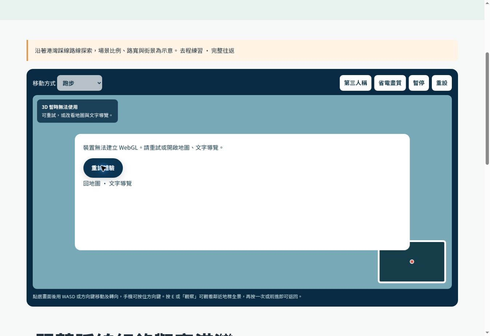
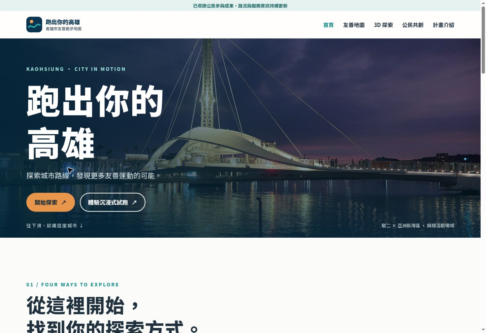

# 測試紀錄

日期：2026-11-24。基準：7d3804b，測試對象為本 PR 的工作版本。環境為雲端 Linux、Chrome，桌面視窗 1348×925；另以 390×844 CSS 像素 iframe 檢查手機版面，**非手機實機**。未取得瀏覽器完整版本或手機機型，不虛構記錄。

## 自動檢查

- `npm run validate`：通過，路線 1、設施 5、店家 2、問卷 5、座談 6、圖卡 2。
- `npm test`：通過。現行 `ride-logic.js` 的投影、切換、重疊返回進度、碰撞、觀察距離與資料測試。
- `test-scene-models.mjs`：真正 Three.js 幾何、現有 street／landmarks／districts／dayi 建構。貼圖與 canvas 像素使用替身，因此僅為 CPU 模型測試。全程 495 meshes、1735 個碰撞框；短程 352 meshes、855 個碰撞框。全程中心線 473 個取樣、短程 220 個取樣，無阻擋。五種角色建構與 dispose 通過。
- 檢查發現原碼頭底座占用返回段，已移動造景偏移並重新通過；報告圖位置未改。
- `test-map.mjs`：通用地圖模組路線選擇、篩選與計數通過。此測試不冒充新 geography.js 的瀏覽器操作；新地圖另以瀏覽器實測。
- JS 語法與 `git diff --check`：交付前檢查。

## 實際瀏覽器操作

| 操作 | 結果 |
|---|---|
| 公民頁重新整理、資料載入 | 通過，來源與母數實際顯示 |
| 展開完整途中需求表格 | 通過，15 項人數與比例可閱讀 |
| 供需比較表格 | 通過，12 項，n=494／n=25 同時顯示 |
| 圖卡開啟、下一張、關閉 | 通過 |
| 地理地圖／報告原圖切換 | 通過，OSM 底圖可見 |
| 報告原圖真愛碼頭聚焦 | 通過，節點文字同步 |
| 活動圖層、廁所篩選 | 通過，定位紀錄 1 筆；廁所 0 筆清楚空狀態 |
| 390px 手機選單 | 通過，展開 aria-expanded=true |
| 390px 完整雙母數表格 | 可展開與閱讀，保留橫向捲動容器 |
| 探索首次開始 | WebGL context 建立失敗；不是 3D 通過 |
| 失敗狀態控制 | 模式與操作停用，顯示錯誤、重試、地圖、文字導覽 |
| 重試 | 可再次執行並回到明確失敗狀態，沒有假裝成功 |

## 尚未驗證

支援 WebGL 的桌機與實機：五模式×兩視角、連續全程行走、導覽／自由切換、四任務、視覺碰撞及第三人稱遮擋、真實觸控、失焦與 context lost/recovery、GPU 資源反覆切換、FPS。沒有測得 FPS，不宣稱 60 FPS。

外部集合點導航 href 已檢查為哈瑪星出口定位；沒有替使用者啟動實際行程。尚未測 GitHub Pages 合併後 production，也未完成主線 GeoJSON。

## 截圖

補充實測：`/kaohsiung-harbor-run/#/routes/bay` 子路徑載入與重新整理通過；服務卡定位至哈瑪星、回總覽清除選取文字通過。首頁保留四入口與縮短主視覺。

